# Sindesk — Showcase

> Demonstração navegável de um SaaS de gestão sindical **que já está em produção em 1 sindicato**.
> Esta pasta roda **sem servidor e sem banco**, com **dados 100% fictícios**.

O **Sindesk** é uma plataforma multi-tenant para sindicatos: cadastro de filiados e empresas, planos de contribuição, cobrança, recebimentos e conciliação bancária. Este showcase reúne a camada de **front-end** do produto e uma **API simulada no navegador**, para que qualquer pessoa explore as telas e as regras de negócio reais sem acesso ao sistema de produção.

> **Aviso:** nenhum dado aqui é real. O sindicato, as empresas, os filiados, os CPFs/CNPJs, a chave Pix e os valores foram inventados. O back-end do Sindesk é privado e não faz parte desta pasta.

---

## Sumário

1. [Para que serve o Sindesk](#para-que-serve-o-sindesk)
2. [Status: em produção](#status-em-produção)
   - [Capturas de tela](#capturas-de-tela)
3. [Como rodar o showcase](#como-rodar-o-showcase)
4. [Credenciais de demonstração](#credenciais-de-demonstração)
5. [Roteiro de exploração](#roteiro-de-exploração)
6. [Como o showcase funciona](#como-o-showcase-funciona)
7. [Stack](#stack)
8. [Estrutura do projeto](#estrutura-do-projeto)
9. [Banco de dados](#banco-de-dados)
10. [Análise de dados: do espelho à evolução](#análise-de-dados-do-espelho-à-evolução)
11. [Cenários fictícios embutidos](#cenários-fictícios-embutidos)
12. [Limitações deste showcase](#limitações-deste-showcase)
13. [Autoria](#autoria)

---

## Para que serve o Sindesk

Sindicatos pequenos e médios costumam controlar filiados, empresas e contribuições em planilhas. O resultado: não se sabe com clareza **quanto deveria entrar, quanto entrou e de quem veio a diferença**. O Sindesk centraliza isso:

- **Filiados** — cadastro completo, histórico de status (ativo, inativo, afastado, aposentado), vínculos profissionais com empresas e alerta de vencimentos próximos.
- **Empresas empregadoras** — CNPJ, situação e quadro de filiados vinculados.
- **Planos de contribuição** — valores **versionados por vigência**: um reajuste não reescreve o passado.
- **Espelho de cobrança** — quanto cada empresa *deveria* pagar na competência, calculado a partir dos filiados cobráveis e do valor vigente do plano.
- **Cobrança via Pix** — QR Code estático (BR Code) gerado a partir do espelho.
- **Recebimentos e conciliação** — compara o esperado com o recebido por empresa e classifica a divergência (conciliado, a menor, a maior, não recebido, sem esperado).
- **Importação assistida de extrato** — lê um CSV do banco e **sugere** a empresa de cada linha por similaridade de texto; a pessoa confirma.
- **Evolução** — série mensal por empresa, com alerta de queda no número de filiados.
- **Dashboard e relatórios** — indicadores do quadro de filiados e exportação em CSV.
- **LGPD** — CPF cifrado em repouso, anonimização de filiado e trilha de auditoria imutável.
- **Perfis de acesso (RBAC)** — administrador, tesoureiro, secretário e assistente enxergam e fazem coisas diferentes.

## Status: em produção

O Sindesk **já está em produção em 1 sindicato**, usado na rotina real de cadastro, cobrança e conciliação. Este showcase não toca nesse ambiente: é uma cópia do front-end ligada a uma API simulada com dados inventados.

---

## Capturas de tela

| | |
| --- | --- |
| 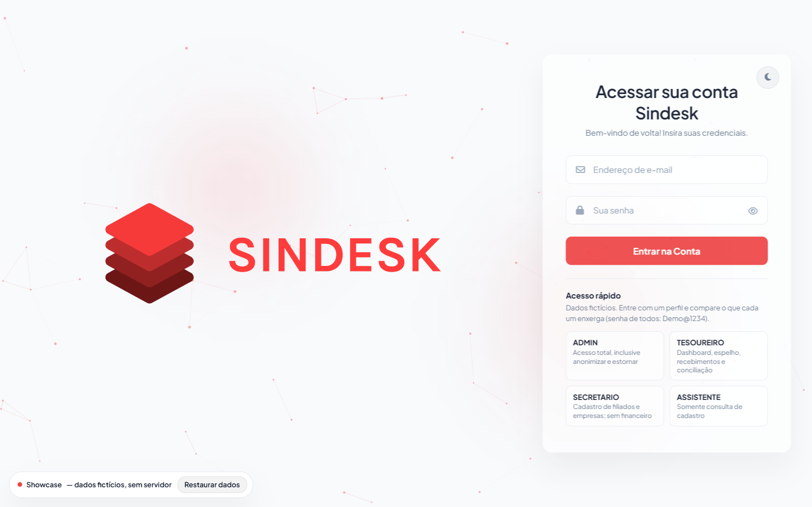<br>Login com acesso rápido por perfil | 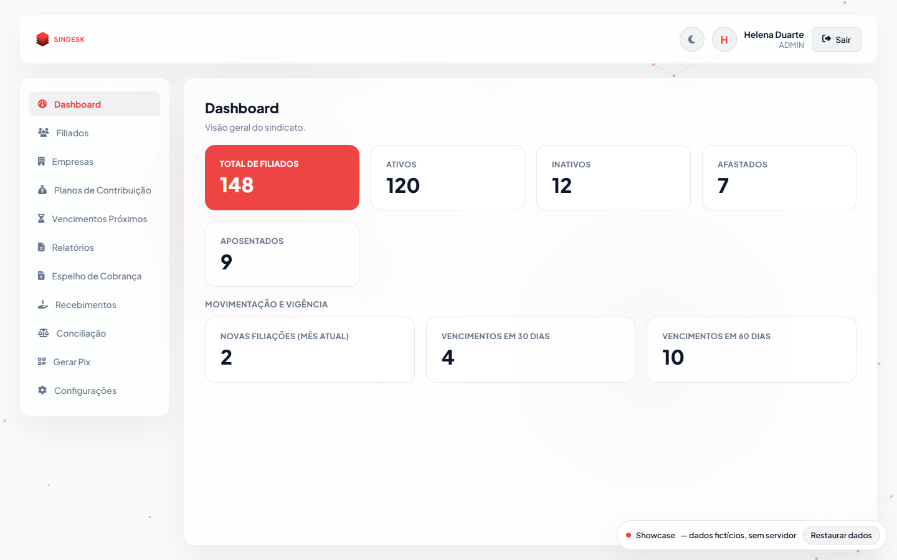<br>Dashboard |
| 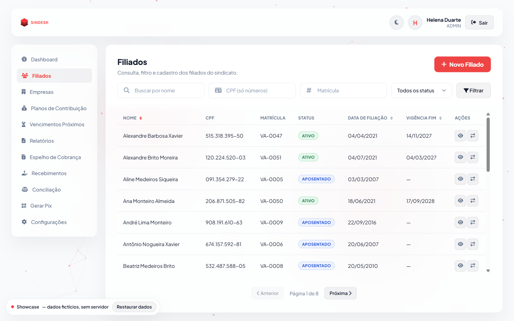<br>Lista de filiados | 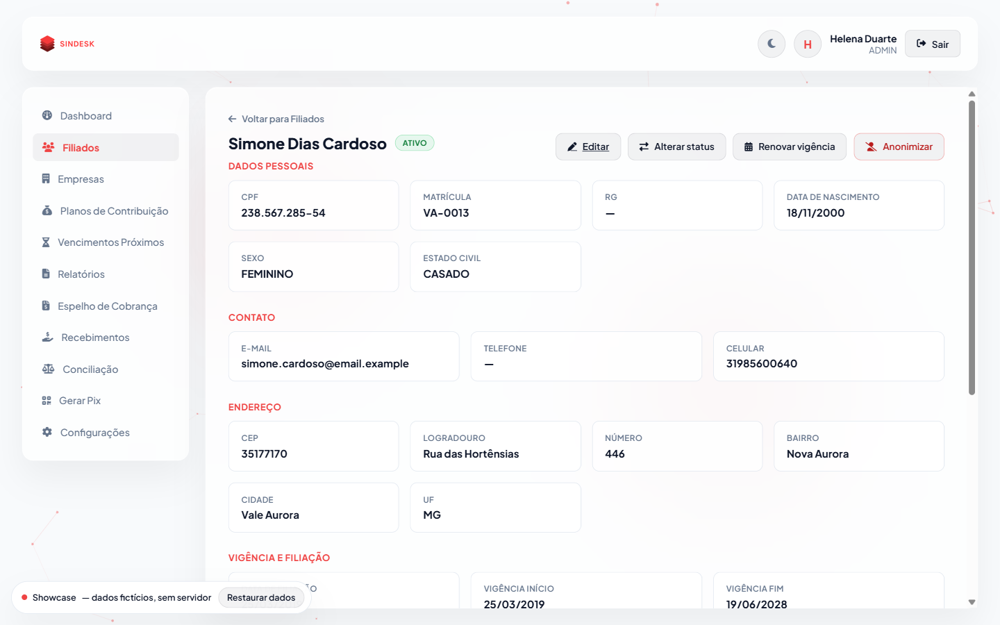<br>Detalhe do filiado |
| 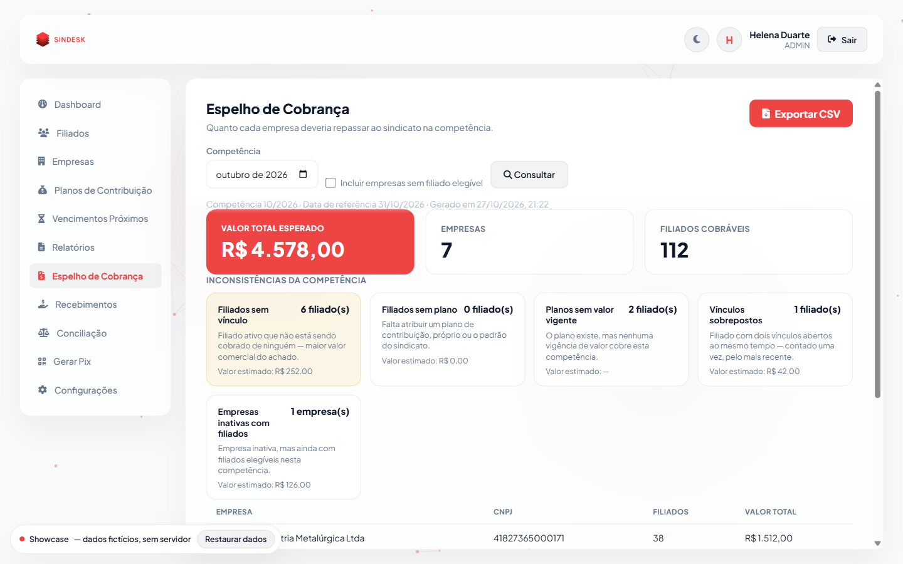<br>Espelho de cobrança | 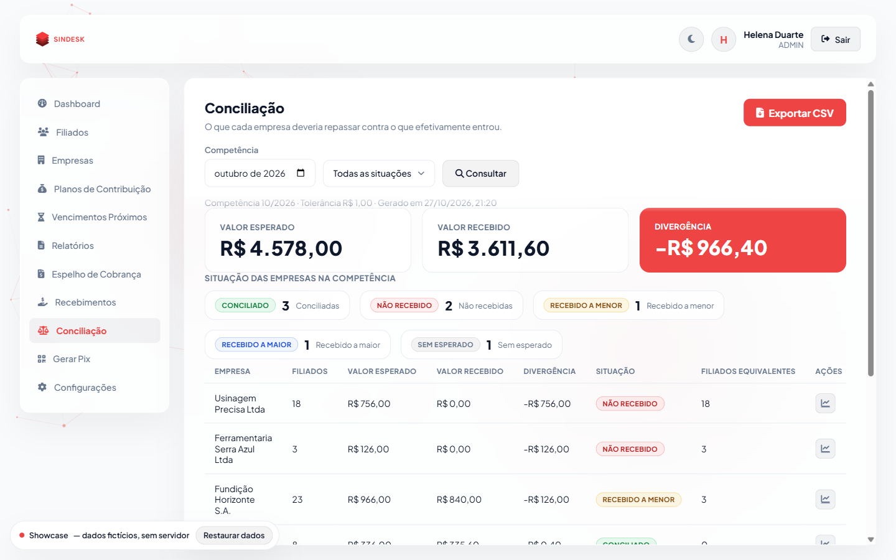<br>Conciliação |
| 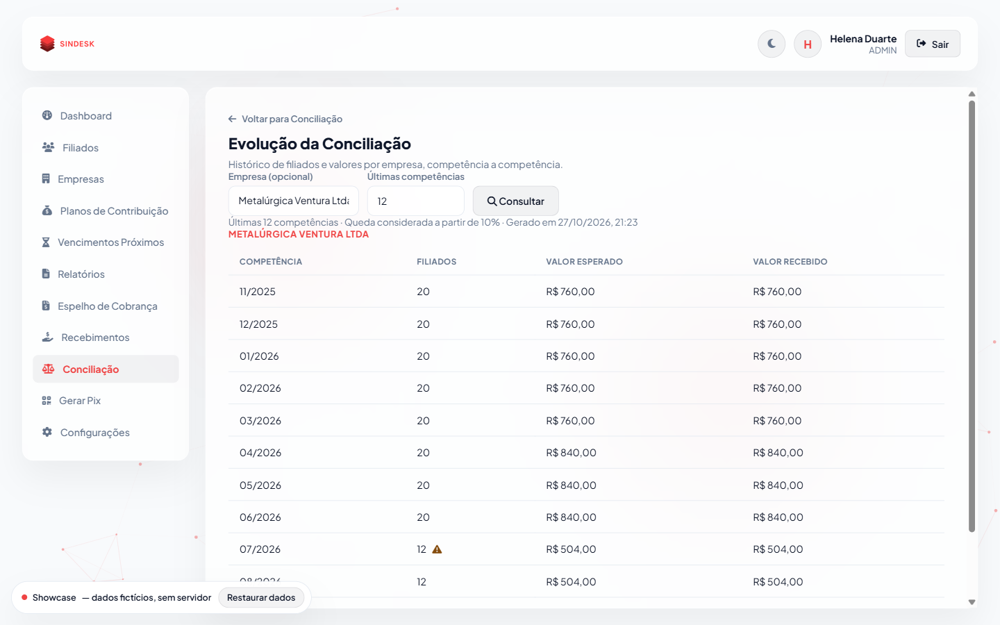<br>Evolução com alerta de queda | 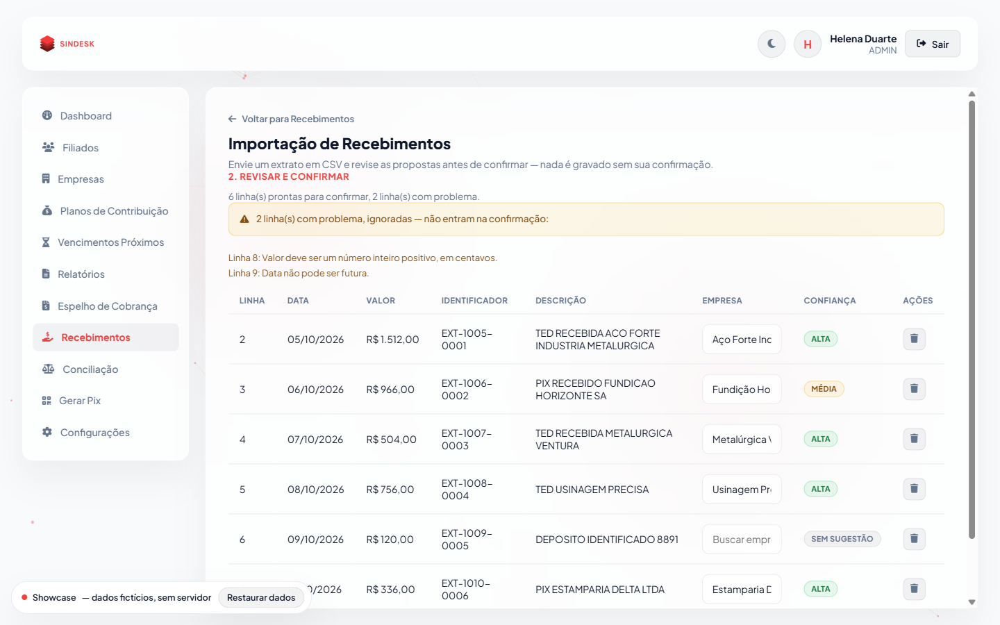<br>Importação assistida de extrato |
| 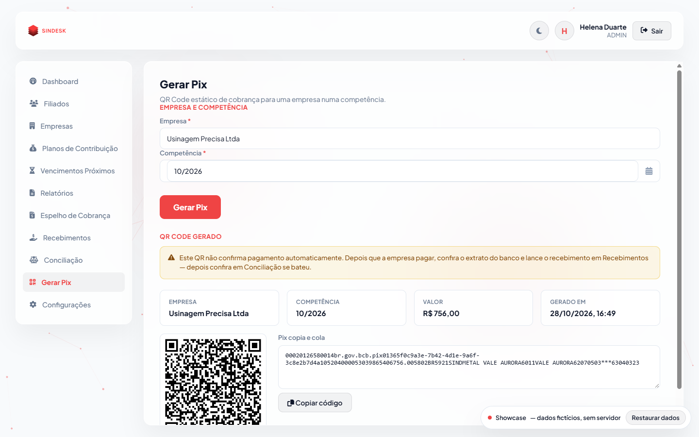<br>QR Code Pix | 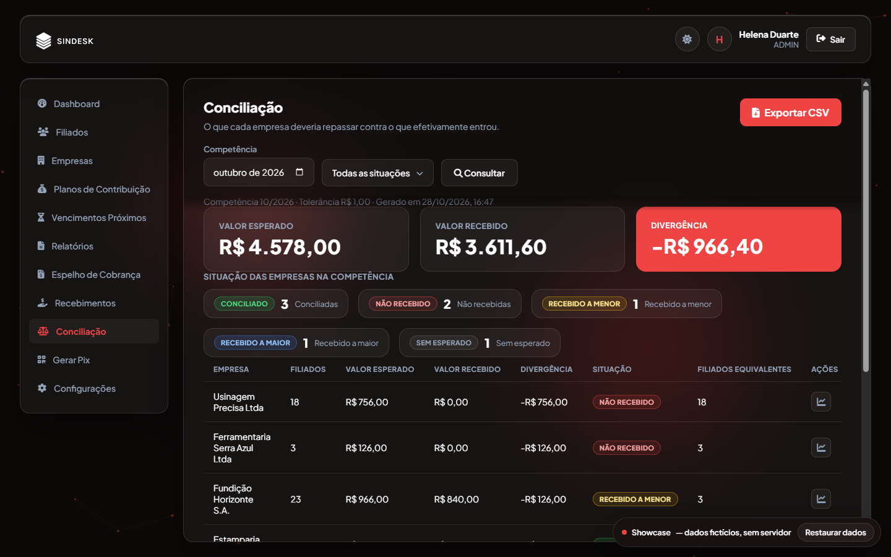<br>Modo escuro |
| 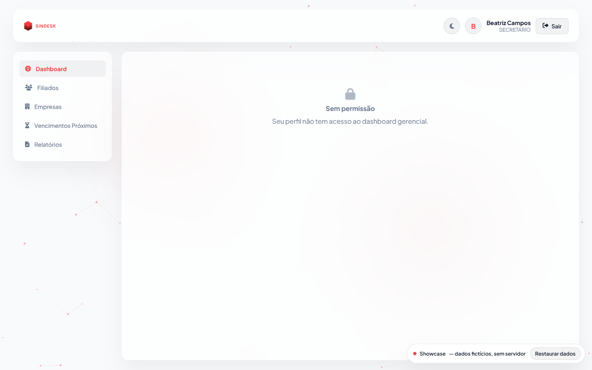<br>Perfil SECRETARIO sem acesso ao dashboard | 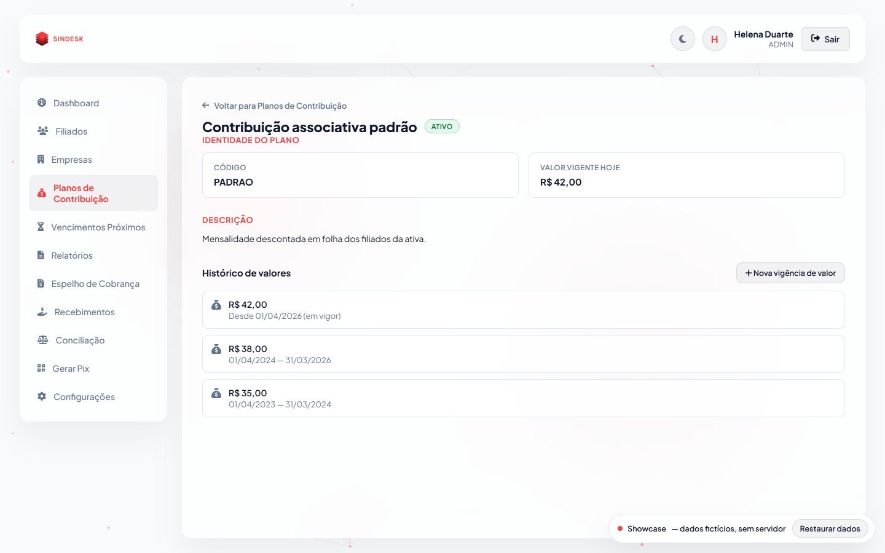<br>Plano com valores por vigência |

Versão mobile: [lista de filiados em 390 px](docs/screenshots/13-mobile-filiados.png).

---

## Como rodar o showcase

O front-end usa **ES Modules**, que não funcionam abrindo o `index.html` direto do disco (`file://`). É preciso servir a pasta por HTTP. Não há `npm install` nem build.

Na raiz do repositório:

```bash
npx serve showcase_front
```

Ou, de dentro da pasta:

```bash
cd showcase_front
python -m http.server 5199
```

Depois abra o endereço indicado (por exemplo `http://localhost:3000` ou `http://localhost:5199`).

**GitHub Pages:** como é 100% estático, basta publicar a pasta `showcase_front/` (ou usar o conteúdo como raiz de um repositório) e ativar o Pages. Todos os caminhos são relativos.

---

## Credenciais de demonstração

Todos os usuários pertencem ao sindicato fictício **Sindicato dos Metalúrgicos de Vale Aurora (MG)**. Senha de todos: `Demo@1234`.

| Perfil | E-mail | O que enxerga |
| --- | --- | --- |
| ADMIN | `admin@sindmetal.example` | Tudo, inclusive anonimizar filiado e estornar recebimento |
| TESOUREIRO | `tesoureiro@sindmetal.example` | Dashboard, espelho, recebimentos, conciliação e Pix |
| SECRETARIO | `secretario@sindmetal.example` | Cadastro de filiados e empresas; **sem** área financeira |
| ASSISTENTE | `assistente@sindmetal.example` | Somente consulta de cadastro |

A tela de login tem um painel de **acesso rápido por perfil**. Entrar com perfis diferentes é a melhor forma de ver o RBAC funcionando: o SECRETARIO, por exemplo, recebe "Sem permissão" no dashboard.

---

## Roteiro de exploração

1. **Dashboard** (como ADMIN) — totais por status, novas filiações e vencimentos de vínculos em 30/60 dias.
2. **Filiados** → abra um filiado → veja histórico de status, vínculos e plano.
3. **Espelho de cobrança** — total esperado do mês por empresa; repare nas empresas com inconsistência (plano sem valor, empresa inativa com filiados).
4. **Pix** — gere o QR Code de uma empresa; o BR Code segue o padrão EMV do Banco Central, com CRC16.
5. **Importação de extrato** — envie `exemplos/extrato-exemplo.csv`. O arquivo traz linhas boas, uma de valor inválido e uma de data futura, para você ver os erros por linha e a confirmação em lote.
6. **Conciliação** — veja os status por empresa (conciliado por tolerância, a menor, a maior, não recebido).
7. **Evolução** — escolha *Metalúrgica Ventura*: perde 8 de 20 filiados há três meses e o alerta de queda dispara.
8. **Perfis** — entre como SECRETARIO e ASSISTENTE e compare os menus e os bloqueios.

O selo no canto da tela tem o botão **Restaurar dados**, que descarta o que você criou ou alterou e volta à base original.

---

## Como o showcase funciona

O front-end original do Sindesk (`public/`) fala com a API por um único módulo, `assets/js/api.js`. O showcase **copia o front-end e troca apenas esse módulo** por uma implementação local com **as mesmas assinaturas e os mesmos formatos de resposta** (44 funções). Com isso, as 19 páginas rodam **sem alteração de lógica**: o que você vê é a interface real.

A API simulada reaplica em JavaScript as regras do back-end:

- matriz de permissões por perfil (RBAC);
- catálogo fechado de códigos de erro (`INVALID_CPF`, `DUPLICATE_CNPJ`, `INVALID_STATUS_TRANSITION`, `VIGENCIA_SOBREPOSTA` etc.) e as mensagens correspondentes;
- validação de CPF/CNPJ e de datas (a checagem de "data futura" usa UTC, como o back-end);
- transições de status como estrutura de dados;
- cálculo do espelho, da conciliação com tolerância e da evolução;
- estorno em vez de exclusão, com bloqueio de estorno duplo;
- geração do BR Code do Pix (verificado byte a byte contra a implementação do back-end em três casos).

O estado vive no `sessionStorage` do navegador: fechar a aba ou clicar em *Restaurar dados* volta à base inicial.

---

## Stack

**Front-end (esta pasta)**

- HTML5, CSS3 e JavaScript (ES Modules), **sem framework e sem biblioteca de gráficos**
- Design tokens em CSS, tema claro/escuro, layout responsivo
- Componentes próprios: select, seletor de data e de mês, partículas na tela de login

**Back-end de produção (privado, fora desta pasta)**

- Node.js, TypeScript e Express
- PostgreSQL e Prisma (SQL cru para agregações analíticas)
- Zod para validação, JWT para autenticação
- Arquitetura em camadas (controller → service → repository), multi-tenant, RBAC, LGPD
- Testes com Vitest + Supertest contra PostgreSQL real

---

## Estrutura do projeto

```text
showcase_front/
├── index.html                      # login (com acesso rápido por perfil)
├── dashboard.html                  # indicadores do quadro de filiados
├── filiados.html · filiado-detalhe.html · filiado-formulario.html
├── empresas.html · empresa-detalhe.html · empresa-formulario.html
├── planos-contribuicao.html · plano-contribuicao-detalhe.html
├── cobrancas-espelho.html          # quanto cada empresa deveria pagar
├── gerar-pix.html                  # QR Code Pix a partir do espelho
├── recebimentos.html · importacao-recebimentos.html
├── conciliacao.html · conciliacao-evolucao.html
├── relatorios.html · vencimentos-proximos.html
├── sindicato-configuracoes.html
├── assets/
│   ├── css/                        # tokens, layout, componentes e um CSS por página
│   └── js/
│       ├── api.js                  # API SIMULADA (único módulo trocado)
│       ├── showcase/               # motor do showcase
│       │   ├── banco-ficticio.js   # base de dados fictícia + persistência na sessão
│       │   ├── motor-calculo.js    # espelho, conciliação e evolução
│       │   ├── similaridade-texto.js  # sugestão de empresa na importação
│       │   ├── pix-br-code.js      # BR Code Pix (EMV + CRC16)
│       │   ├── csv.js              # leitura e geração de CSV
│       │   └── utilitarios.js      # CPF/CNPJ, datas em UTC etc.
│       ├── showcase-banner.js      # selo "dados fictícios" + restaurar
│       ├── showcase-login.js       # acesso rápido por perfil
│       └── <página>.js · acao-*.js # lógica de cada tela e de cada ação
├── exemplos/extrato-exemplo.csv    # extrato para testar a importação
└── docs/screenshots/               # capturas de tela
```

---

## Banco de dados

O banco de produção é **PostgreSQL**, modelado com Prisma em **13 tabelas**. O showcase não usa banco, mas as regras acima derivam deste modelo.

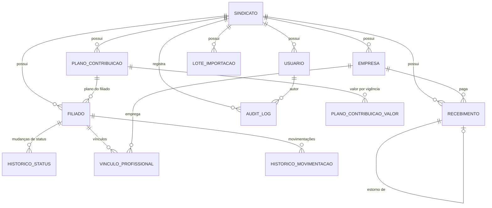

| Tabela | Papel |
| --- | --- |
| `sindicatos` | O tenant. Guarda o plano padrão, a tolerância de conciliação e a chave Pix |
| `usuarios` | Usuários do sindicato, com perfil (RBAC) |
| `filiados` | Cadastro do filiado; CPF cifrado + hash |
| `historico_status` | Cada mudança de status do filiado |
| `vinculos_profissionais` | Filiado ↔ empresa, com início e fim |
| `historico_movimentacoes` | Abertura e fechamento de vínculos |
| `empresas` | Empresas empregadoras (CNPJ único por sindicato) |
| `planos_contribuicao` | Planos de contribuição |
| `planos_contribuicao_valores` | Valor do plano por vigência (versionado) |
| `recebimentos` | Valores recebidos por empresa e competência; estorno aponta para o original |
| `lotes_importacao` | Lotes de extrato importado |
| `audit_logs` | Trilha de auditoria imutável |
| `rate_limit_hits` | Contadores do limitador de tentativas de login |

**Decisões de modelagem que valem registrar**

- **Dinheiro em centavos inteiros.** Nada de ponto flutuante: soma e comparação de valores são exatas.
- **Vigência versionada.** O valor de um plano tem início de vigência; um reajuste cria uma linha nova e o passado continua calculável. Sobreposição é rejeitada (`VIGENCIA_SOBREPOSTA`).
- **Estorno em vez de exclusão.** Um recebimento errado é estornado por um novo registro que aponta para o original; estornar duas vezes é erro.
- **Isolamento por tenant.** Toda tabela de negócio carrega `sindicato_id`; o identificador do sindicato vem sempre do token de autenticação, nunca do corpo da requisição, e acessar recurso de outro sindicato responde 404.
- **LGPD.** CPF nunca é guardado em texto puro: um hash determinístico sustenta unicidade e busca, e uma versão cifrada serve só para exibição. Depois da anonimização o CPF deixa de ser exposto.
- **Auditoria transacional.** A trilha de auditoria é gravada na mesma transação da escrita que a originou; se falhar, a operação é desfeita.
- **Datas com fuso** (`TIMESTAMPTZ`), banco em `snake_case` e API em `camelCase`.

---

## Análise de dados: do espelho à evolução

A parte analítica do produto segue uma trilha em quatro etapas, todas reproduzidas neste showcase:

```text
Espelho de cobrança → Recebimento → Conciliação → Evolução
   (esperado)          (realizado)   (diferença)    (tendência)
```

1. **Espelho** — para cada empresa, conta os filiados *cobráveis* na competência e multiplica pelo valor vigente do plano. Casos sem cálculo possível (plano sem valor vigente, empresa inativa com filiados) aparecem como **alertas**, não como zero silencioso.
2. **Recebimento** — registra o que entrou, manualmente ou pela importação assistida de extrato (com sugestão por similaridade de texto e nível de confiança ALTA/MÉDIA).
3. **Conciliação** — compara esperado × recebido por empresa e classifica: `CONCILIADO` (inclusive dentro da tolerância), `A_MENOR`, `A_MAIOR`, `NAO_RECEBIDO`, `SEM_ESPERADO`. Para divergências a menor, indica quantos filiados a diferença equivale.
4. **Evolução** — série mensal por empresa; quando o número de filiados da empresa cai mais de 10% em relação à competência anterior, o alerta de queda aparece na competência correspondente.

O **dashboard** complementa com indicadores do quadro: total, ativos, inativos, afastados, aposentados, novas filiações e vínculos que vencem em 30 e 60 dias.

---

## Cenários fictícios embutidos

A base foi desenhada para que cada regra tenha um caso visível:

| Cenário | O que demonstra |
| --- | --- |
| Estamparia Delta paga R$ 0,40 a menos | `CONCILIADO` por tolerância de R$ 1,00 |
| Fundição Horizonte paga a menor | `A_MENOR`, diferença equivalente a 3 filiados |
| Usinagem Precisa não pagou | `NAO_RECEBIDO` |
| Caldeiraria Boa Vista paga a maior | `A_MAIOR` |
| Tornearia Nova Era sem filiados cobráveis, mas com pagamento | `SEM_ESPERADO` |
| Serra Azul inativa com 3 filiados | alerta `EMPRESA_INATIVA_COM_FILIADOS` |
| 2 filiados em plano sem valor vigente | alerta `PLANO_SEM_VALOR_VIGENTE`; valor estimado "—" |
| 6 filiados sem vínculo com empresa | ficam fora do espelho |
| 1 vínculo sobreposto | inconsistência de cadastro visível |
| Metalúrgica Ventura perde 8 de 20 filiados | alerta de queda na evolução |
| Usinagem Precisa perde 2 de 17 filiados | queda menor (cerca de 12%), que também passa do limiar de 10% |
| Reajuste de plano (R$ 760 → R$ 840) | vigência versionada visível na série |
| Lançamento duplicado estornado | estorno em vez de exclusão |
| 1 filiado anonimizado | CPF deixa de ser exposto |
| Filiados afastados e aposentados | status e regras de cobrança por situação |

---

## Limitações deste showcase

- **A API é simulada.** Não há servidor, autenticação real, banco nem persistência além da sessão do navegador.
- **O back-end não está aqui.** Código, migrações e testes do back-end são privados.
- **Escopo demonstrado:** cadastro, cobrança via Pix manual, recebimentos, conciliação, evolução, dashboard e relatórios. Emissão de cobrança integrada a banco (boletos, CNAB, webhooks) **não** faz parte do produto atual.
- **Dados fictícios.** A chave Pix e o BR Code gerados não correspondem a nenhuma conta real; o QR Code serve para demonstração.

---

## Autoria

O Sindesk foi desenvolvido em dupla.

- **João Vítor Oliveira de Alcantara** — **front-end** e **análise de dados** (indicadores do dashboard, espelho de cobrança, conciliação e evolução). [LinkedIn](https://www.linkedin.com/in/joão-vítor-oliveira-de-alcantara-a53695339) · [GitHub](https://github.com/vittoralcan)
- **Alan Gabriel** — **back-end** e arquitetura da API. [LinkedIn](https://www.linkedin.com/in/alan-gabriel-araujo/) · [GitHub](https://github.com/Alanado)
